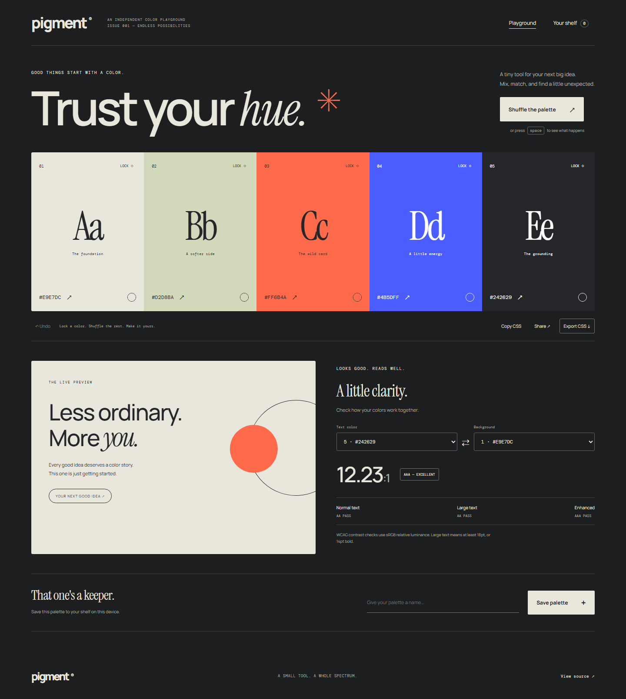

# Pigment

A color workbench for finding a palette you actually want to use. Keep a few colors, shuffle the rest, check the contrast, and export the result as CSS variables.

[Live demo](https://goshkaaaa.github.io/pigment/) · [Mobile preview](docs/mobile.png) · [Checks](https://github.com/goshkaaaa/pigment/actions)



## What it does

- Generate coordinated five-color palettes; lock individual colors before shuffling.
- Edit any swatch with the browser color picker and undo up to 20 changes.
- Copy individual hex values or the full CSS variable set; download a `.css` file.
- Share a palette through a URL containing its five hex values.
- Compare foreground and background colors using WCAG relative luminance and AA/AAA thresholds.
- Save up to 40 named palettes on this device, reopen them, or remove them.

Press Space to shuffle while you are outside a form control. Clipboard actions require a secure context such as HTTPS or localhost. CSS download remains available if clipboard access is denied.

## Run locally

Use Node.js 24 LTS and npm.

```sh
npm ci
npm run dev
```

Open the local URL printed by Vite.

```sh
npm run lint
npm test
npx playwright install chromium
npm run test:e2e
npm run build
npm run preview
```

The production build goes to `dist/`. GitHub Actions builds with `/pigment/` as the base path. Verify and Deploy demo workflows are included. The current demo uses a separately published `gh-pages` branch with a locally verified build. Select GitHub Actions as the Pages source to enable automatic deployments when Actions is available.

## Inside

Vue 3 Composition API, JavaScript, Vite, and plain CSS. `src/color.js` contains framework-independent functions for HSL conversion, contrast, palette generation, URL parsing, and CSS export. The component owns interaction state and a versioned local palette library. No backend, accounts, API keys, or component library.

Unit tests check known contrast ratios and RGB primaries, locked colors, invalid share URLs, and CSS output. Desktop and mobile browser tests cover generation, undo, library persistence, shared links, exports, and accessibility of the initial palette.

## Boundaries

Contrast scores apply to the two selected solid sRGB colors. They do not certify an entire design: font size, transparency, images, and interaction states need their own checks. A deliberately low-contrast palette can also make its live preview difficult to read; the contrast panel reports this.

Your shelf is stored in this browser, not synced across devices. Shared links include colors but not names or saved palettes. Google Fonts are optional, with local fallbacks.

MIT license.
